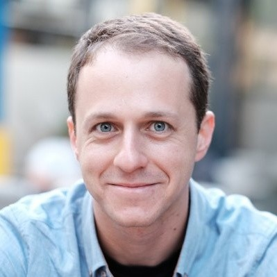
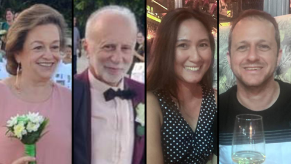

# In Loving Memory of Dima Gershovich

  

It is with a heavy heart that we dedicate this space to the memory of **Dima Gershovich**, our dear friend, brilliant colleague, and an extraordinary human being.

Dima was tragically taken from us on April 5, 2026, alongside his beloved wife Lucille Jane and his parents Vladimir and Lena, when an Iranian ballistic missile struck their building in Haifa. He was 42 years old. Their loss wiped out two generations of one family in a single moment.

### A Brilliant Mind & Passionate Engineer

Dima was a Senior Software Engineer at JFrog for 10 years, where he guided many generations of developers with his kindness and passionate approach. He earned his B.A. in Computer Science *cum laude* from the Technion – Israel Institute of Technology, and his M.Sc. from Reichman University. With over 21 years of experience in software engineering, Dima had built an impressive career across leading technology companies before joining JFrog.

At JFrog, Dima was one of the first developers to build [JFrog Xray](https://jfrog.com/xray/) — the company's software composition analysis platform used by thousands of organizations worldwide. He didn't just write code – he built systems with craftsmanship and vision. His open-source contributions live on, including his work on [priority-channels](https://github.com/dmgrit/priority-channels) for Go. Dima was an active member of the open-source community, always sharing his knowledge and giving back.

A Go enthusiast at heart, you can watch Dima share his passion in this [Golang talk](https://youtu.be/xbSlPYlRt1c).

A family friend described him as "gifted – a prodigy who studied in advanced classes from childhood."

### A Man of Many Talents

Beyond his professional excellence, Dima was a true Renaissance man:
* **Polyglot:** Dima was fluent in **11 languages**, including Hebrew, English, Russian, Tagalog, and Arabic, reflecting his deep love for cultures and people.
* **Musician:** He was a gifted musician, expressing his soul through the keys of a piano and the strings of a guitar. Watch him play [*"Gorod Kotorogo Net"* ("The City That Doesn't Exist")](dima-piano-cover.mp4) on piano.
* **Gentle Soul:** Above all, Dima was known for his gentle nature, his kindness, and the quiet strength he brought to every room.

### Family

  

Dima was the only child of Vladimir and Lena Gershovich, who had immigrated to Israel from Kyiv. Lena was a well-known and beloved voice and acting coach at the Nissan Nativ Acting Studio, where for decades she trained generations of Israeli actors. Vladimir spent many years working at the Technion — the same institution where Dima would later study.

Dima met his wife, Lucille-Jane, during a trip to the Philippines, her home country. She moved to Israel to build a life with him, working at a local kindergarten, and the two married in April 2024, dreaming of building a family of their own.

Dima, Lucille-Jane, Vladimir, and Lena were together when they were lost, and they remain together in memory.

### In the News

* [Ynetnews](https://www.ynetnews.com/article/skxjv8znwx)
* [The Times of Israel – "Four members of the Gershovitz family identified as victims of Haifa missile attack"](https://www.timesofisrael.com/four-members-of-the-gershovitz-family-identified-as-victims-of-haifa-missile-attack/)
* [Technion – "The pain is one: the pain of lives cut short in an instant"](https://www.technion.ac.il/en/blog/article/the-pain-is-one-the-pain-of-lives-cut-short-in-an-instant/)

### Legacy

Dima's contribution to the tech community and to his colleagues at JFrog and beyond will never be forgotten. He was more than a coder – he was a mentor and a friend.

**Rest in peace, Dima. You and your family will forever remain in our hearts.**

---

*[Visit Dima's GitHub Profile](https://github.com/dmgrit)*
